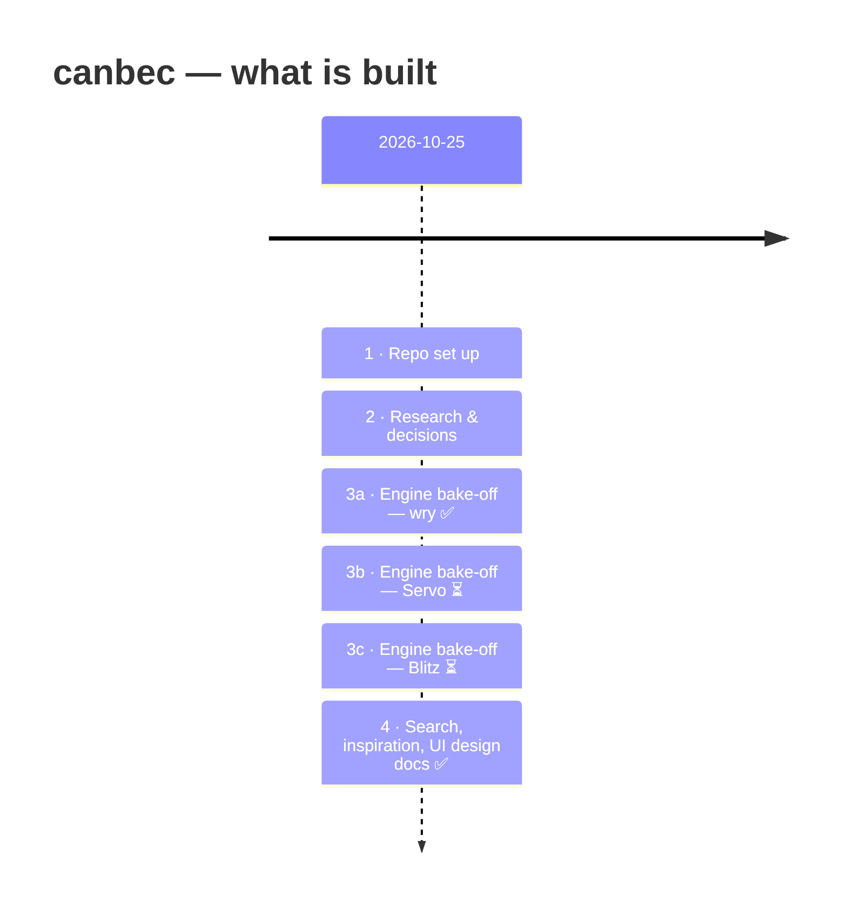

<div align="center">


# canbec

### **C**ontrol **A**I, **N**ot **B**e **C**ontrolled

*A lightweight, cross-platform browser written in Rust that hides AI slop, ads and adult content,
so you can browse the web as a human, not a parrot.*


</div>

---

## 🛤️ Journey so far



| # | Step | Status | Read more |
|:-:|------|:------:|-----------|
| 1 | Repo set up: `src/`, `test/`, `docs/` | ✅ | |
| 2 | Kickoff research: what my apps need from an engine | ✅ | [01-initial-findings](docs/research/01-initial-findings.md) |
| 3 | Engine bake-off: wry vs Servo vs Blitz | 🔄 | [src/prototypes/](src/prototypes/) · [05-engine-bakeoff](docs/research/05-engine-bakeoff.md) |
| 4 | Search without AI: comparison and plan | ✅ | [02-search](docs/research/02-search.md) |
| 5 | Open-source inspiration | ✅ | [03-inspiration](docs/research/03-inspiration.md) |
| 6 | UI: vertical tabs, 20-tab discipline, slop tagging | ✅ design | [04-ui-and-tabs](docs/research/04-ui-and-tabs.md) |

## 🧪 Engine bake-off

Test page: [the local Blazor test app](http://localhost:5080). It's a Blazor WebAssembly app
that uses MapLibre (WebGL), Chart.js (canvas) and a QR scanner (camera).

| wry (system webview) | Servo | Blitz |
|:-:|:-:|:-:|
|  | ⏳ building | ⏳ building |
| ✅ Renders fully · 1.5 MB binary | | |

## 🎯 Features

| Feature | Idea | Progress |
|---|---|---|
| 🧱 **Engine** | Runs real web apps (WASM, WebGL, Canvas) on all 3 OSes | `▓▓▓░░░░░░░` prototyping |
| 🔞 **Adult lock** | Built into the browser **and** system DNS (family resolver); no off switch | `▓░░░░░░░░░` researched |
| 🔎 **Human search** | Results first seen after 2023 marked *obsolete*; NoAI DuckDuckGo first | `▓▓░░░░░░░░` designed |
| 🫥 **AI spoilers** | AI images hidden behind a click-to-reveal overlay (C2PA / IPTC first) | `▓░░░░░░░░░` researched |
| ⚠️ **Slop tagging** | One click marks a site; it gets a warning border on every later visit | `▓▓░░░░░░░░` designed |
| 🚫 **No ads** | Ads blurred and covered in grey hatching | `▓░░░░░░░░░` researched |
| 🗂️ **Tab discipline** | Vertical tabs, at most 20 open, auto-archive to folders, soft-delete after 2 months | `▓▓░░░░░░░░` designed |

## 📁 Layout

```
src/          the browser (coming next)
test/         tests
docs/         research notes, decisions, screenshots
src/prototypes/throwaway engine experiments (one crate each)
tools/        small helper scripts (e.g. window screenshots)
```
