<a id="readme-top"></a>

<div align="center">
  <a href="https://github.com/Cod3rs-org/canbec">
    
  </a>

  <h3 align="center">canbec</h3>

  <p align="center"><strong>C</strong>ontrol <strong>A</strong>I, <strong>N</strong>ot <strong>B</strong>e <strong>C</strong>ontrolled. A lightweight browser that hides AI slop, ads and infinite feeds</p>

[](https://github.com/Cod3rs-org/canbec/actions/workflows/ci.yml) [](https://github.com/Cod3rs-org/canbec/commits)<br>


  <p align="center">
    <a href="#-try-it"><strong>Try it</strong></a>
    &middot;
    <a href="#-benchmarks">Benchmarks</a>
    &middot;
    <a href="https://github.com/Cod3rs-org/canbec/issues/new?labels=bug">Report Bug</a>
    &middot;
    <a href="https://github.com/Cod3rs-org/canbec/issues/new?labels=enhancement">Request Feature</a>
  </p>
</div>

<hr>

<table>
  <tr>
    <td nowrap>&nbsp;<strong>Runs&nbsp;on</strong></td>
    <td>Windows, Linux and macOS</td>
  </tr>
  <tr>
    <td nowrap>&nbsp;<strong>Highlights</strong></td>
    <td>Hard limits on feeds, ads become grey hatching, max 20 tabs, four layouts, about 4 MB</td>
  </tr>
  <tr>
    <td nowrap>&nbsp;<strong>Run</strong></td>
    <td><code>cargo run --release -p canbec</code></td>
  </tr>
  <tr>
    <td nowrap>&nbsp;<strong>Status</strong></td>
    <td>Alpha, <a href="https://github.com/Cod3rs-org/canbec/releases">v0.1.0</a> released, see <a href="#️-what-is-done-so-far">What is done so far</a></td>
  </tr>
</table>

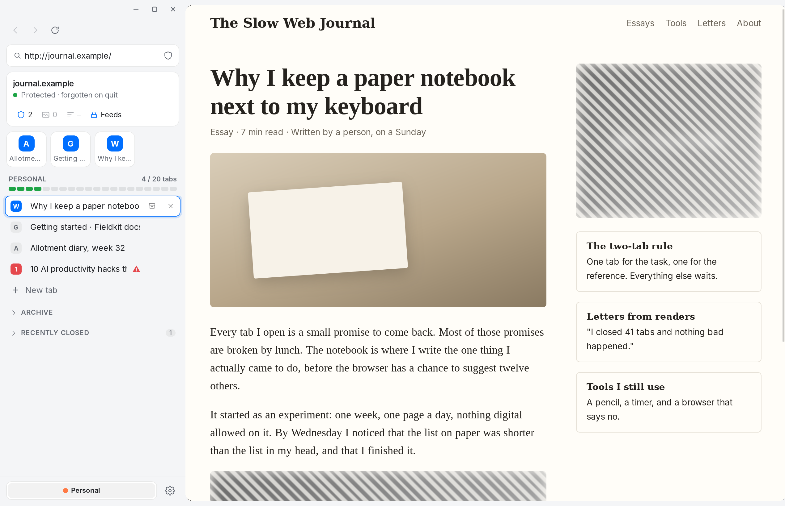

## Why I made this

The web got loud. AI-generated pages bury the human ones, feeds are built so they never end, and
twenty forgotten tabs are nagging you in the background. I wanted a browser where I can live my life
as a normal human being and not as a parrot, so I built one.

canbec is a quiet browser with hard limits. You set them once, and you can't just turn them off in
a weak moment.

## ✨ 5 reasons to switch

1. 🔕 **Hard limits for weak moments.** Infinite feeds are gone. If you really need them, you have
   to go to settings and you get **6 hours max**. Adult content has **no off switch** at all.
2. ⚠️ **Mark AI slop once, get warned forever.** One click on the shield, and the site gets a
   red frame on every visit. AI images get a spoiler, and search marks pages first seen after 2023.
3. 🗂️ **20 tabs, no hoarding.** Idle tabs move to folders by themselves and disappear after two
   months, but nothing is ever really deleted.
4. 🪶 **Small and fast.** 4 MB app, opens in 0.3 s and uses about **2.7× less memory than Safari**
   ([macOS](docs/benchmarks/2026-10-25-macos.md)). On Windows it uses about 15% less than Chrome
   and about 4× less than Edge ([Windows](docs/benchmarks/2026-10-26-windows.md)).
5. 🕵️ **Nobody tracks you.** Every start is a fresh browser: cookies, storage and cache from last
   time are gone, every site sees a slightly different fingerprint, tracker requests are blocked
   and `utm_`/`fbclid` junk is cut from links. You stay logged in only where you say so. No
   telemetry, no accounts.

| | |
|:-:|:-:|
| 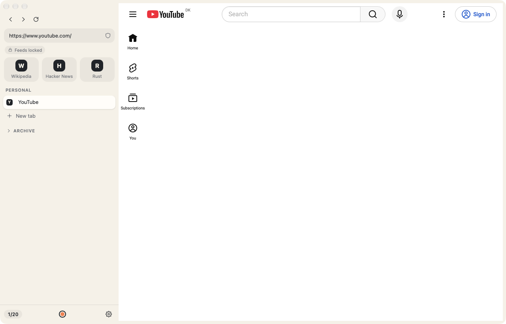 | 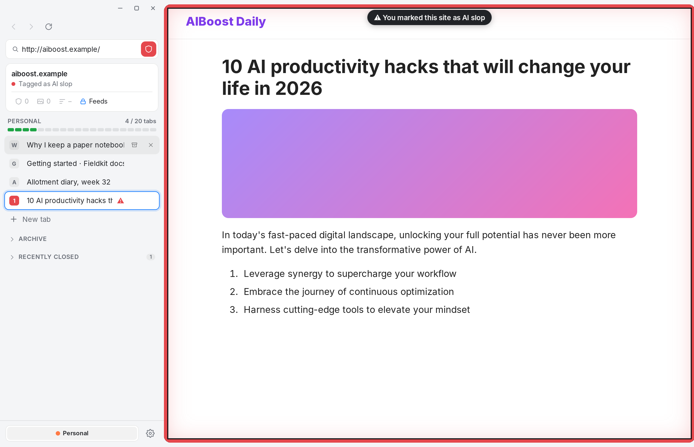 |
| 🔕 **No infinite feeds.** The YouTube home feed is just gone (also Reddit, X, Instagram, TikTok, Bluesky, Tumblr and more, plus your own in `feeds.txt`). Unlocking is only in settings, **6 hours max**. | ⚠️ **What you tag stays tagged.** One click on the shield, and the site has a red frame on every visit. Share your list or follow others. Images whose metadata says "AI-generated" stay blurred until you click. |
| 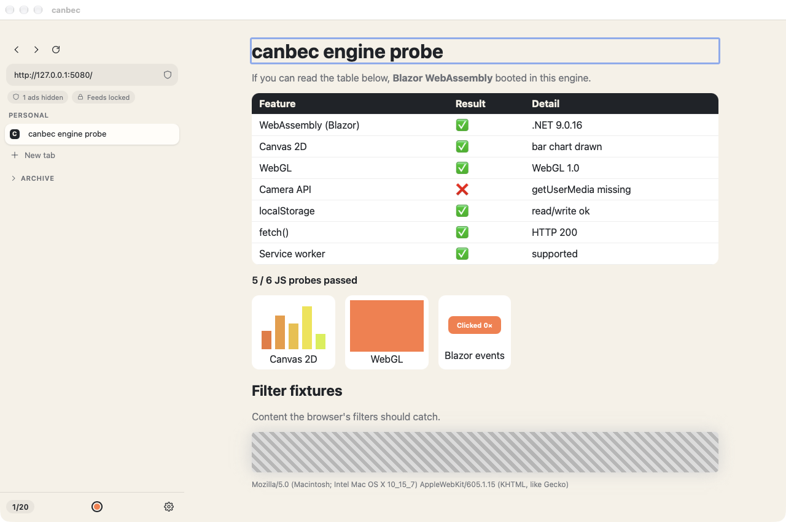 | 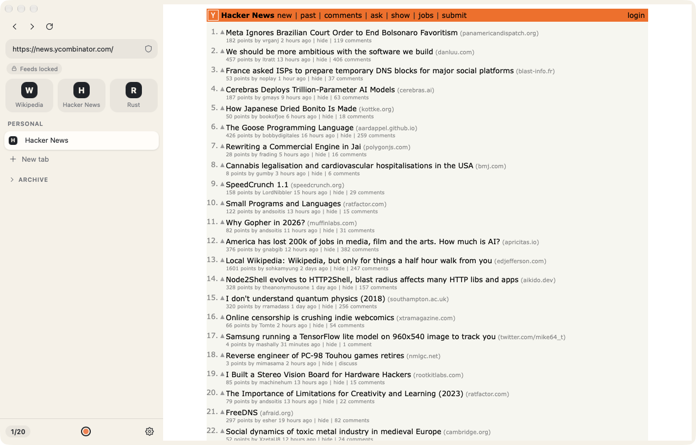 |
| 🚫 **Ads become grey hatching.** About 24k EasyList rules, updated every week. The layout stays the same, the ad just doesn't get your attention. | 🧘 **Calm by default.** Vertical tabs, max 20 open, idle tabs move to folders by themselves. |
| 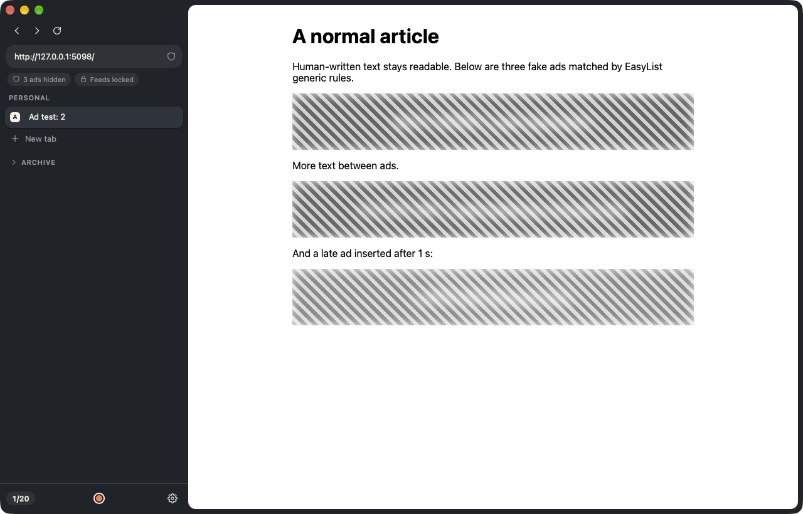 | 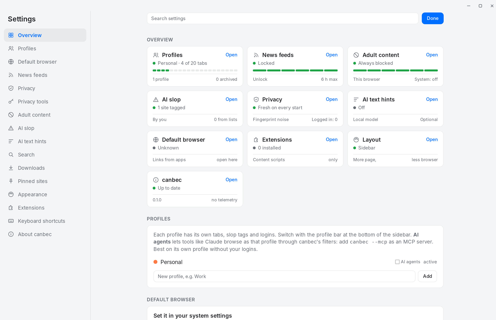 |
| 🧪 **Even late ads get covered**, also the ones a page adds after it loaded. | ⚙️ **Full-window settings** with an overview of everything at a glance, and search. Feeds unlock only after a 10 s wait. |
| 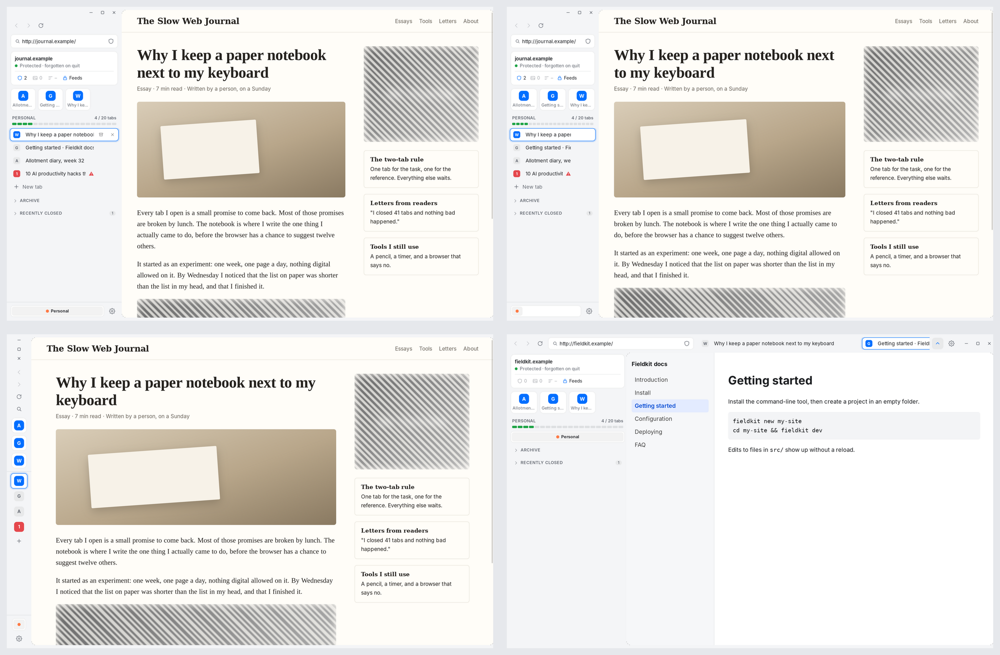 | 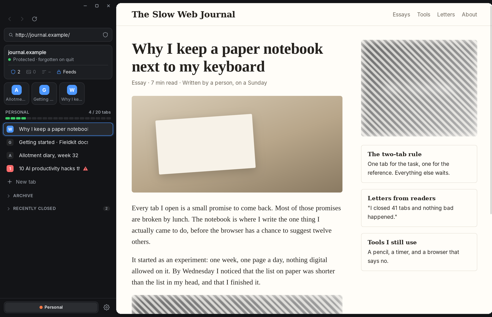 |
| 🪟 **As much browser as you want.** Sidebar, Compact, an icon Rail that opens when you type, or one slim Top bar with a ▾ panel. Settings → Appearance. | 🌙 **Light and dark**, following your system. Or write your own colours in `theme.css`. |

And under the hood:
- ⌨️ **Normal browser stuff works:** Cmd/Ctrl+T, W, L, R, D (pin), F (find), +/-/0 (zoom, kept per site), `[` `]` (back/forward per tab),
  Shift+T (reopen a closed tab; "Recently closed" in the sidebar is searchable), copy/paste, downloads to your Downloads folder.
- 🎥 **Camera and microphone ask first**, per site, and canbec never saves the answer (on Linux the question shows in the sidebar).
- 🔗 **One canbec at a time:** links from other apps open as a new tab, and canbec can be your default browser.
- 🔞 **Adult content is blocked** on every navigation, also offline, no off switch. Optional: family DNS for the whole computer, one click in settings.
- 🫥 **AI images get a spoiler overlay** when their metadata says they're AI-made.
- 🕵️ **A fake device:** sites see common hardware (cores, screen, GPU) similar to yours, never your own, different on every site.
- 🧩 **Chrome extensions that only change pages** (content scripts + storage) run unchanged; a Claude skill ports the rest.
- 🧠 **AI text hints (optional):** a small model on your computer guesses whether a page reads like AI. Off by default, a 90 MB download that continues where it stopped.
- 🔎 **Human search**: results first seen after ChatGPT came out get an *AI era* badge. For now, search goes
  to [DuckDuckGo NoAI](https://noai.duckduckgo.com).
- 🦀 **A second engine:** the same interface and filters also run on Servo, a browser engine written in Rust (`canbec-servo --window`, experimental).

## 🛤️ What is done so far

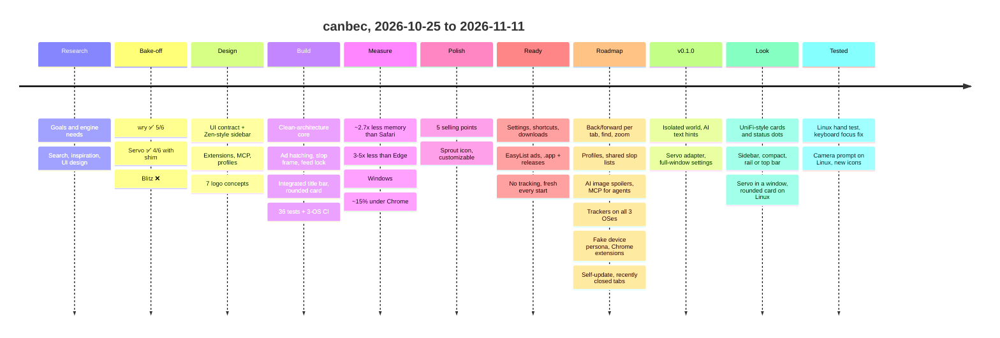

| # | Step | Status | Read more |
|:-:|------|:------:|-----------|
| 1 | Repo set up | ✅ | |
| 2 | First research: what real apps need from an engine | ✅ | [01](docs/research/01-initial-findings.md) |
| 3 | Search without AI: comparison and plan | ✅ | [02](docs/research/02-search.md) |
| 4 | Open-source inspiration | ✅ | [03](docs/research/03-inspiration.md) |
| 5 | UI: vertical tabs, 20-tab discipline, slop tagging | ✅ | [04](docs/research/04-ui-and-tabs.md) |
| 6 | Engine bake-off with a local Blazor WASM probe | ✅ | [05](docs/research/05-engine-bakeoff.md) |
| 7 | Extensibility: any engine, Chrome extension subset, feed lock, MCP, profiles | ✅ design | [06](docs/research/06-extensibility.md) |
| 8 | Sidebar UI (vanilla HTML/CSS/JS, ~16 KB) | ✅ | [ui-contract](docs/architecture/ui-contract.md) |
| 9 | **First working browser** (domain / application / infrastructure / app) | ✅ | [src/](src/) |
| 10 | Integrated title bar (macOS) + own window buttons (Windows / Linux), rounded card | ✅ | |
| 11 | Benchmarks vs Safari and Edge: about 2.7× less memory | ✅ | [benchmarks](docs/benchmarks/2026-10-25-macos.md) |
| 12 | 5 selling points, sprout as the default icon, customizable app icon | ✅ | [icons](#-icons) |
| 13 | Settings panel: feed unlock after a 10 s wait, pinned sites, live icon picker | ✅ | [contract](docs/architecture/ui-contract.md) |
| 14 | Keyboard shortcuts, macOS Edit menu (copy/paste), downloads | ✅ | |
| 15 | Real ad covering with EasyList, updated weekly | ✅ | [benchmarks](docs/benchmarks/2026-10-25-macos.md) |
| 16 | `canbec.app` bundle, packaged builds for 3 OSes, tag → GitHub release | ✅ | [ci.yml](.github/workflows/ci.yml) |
| 17 | **No tracking:** fresh browser every start, fingerprint noise, tracker blocking, clean links, privacy tools | ✅ | [08](docs/research/08-privacy.md) |
| 18 | Full plan: 33 issues in 4 milestones (release, every OS equal, human web, agents & extensions) | 📝 | [ROADMAP](docs/ROADMAP.md) |
| 19 | Browser basics: back/forward per tab, find in page, zoom per site, Cmd+click → new tab, camera/mic prompts, crash reload | ✅ | [#6–#11](https://github.com/Cod3rs-org/canbec/milestone/1) |
| 20 | Tracker blocking with EasyPrivacy path rules on macOS and Linux (tested); Windows (WebView2) wired, needs a hand test | ✅ / 🧪 | [#12](https://github.com/Cod3rs-org/canbec/issues/12) [#13](https://github.com/Cod3rs-org/canbec/issues/13) [#21](https://github.com/Cod3rs-org/canbec/issues/21) |
| 21 | Feed lock on 12 sites + your own `feeds.txt` | ✅ | [#22](https://github.com/Cod3rs-org/canbec/issues/22) |
| 22 | **Profiles:** own tabs, tags and logins per profile; shared slop lists | ✅ | [#26](https://github.com/Cod3rs-org/canbec/issues/26) [#27](https://github.com/Cod3rs-org/canbec/issues/27) |
| 23 | **AI images blurred** when their metadata says so | ✅ | [#24](https://github.com/Cod3rs-org/canbec/issues/24) |
| 24 | **MCP server:** AI agents browse through the same filters, only when you allow it | ✅ | [#28](https://github.com/Cod3rs-org/canbec/issues/28) |
| 25 | Windows benchmarks vs Chrome and Edge: about 15% less memory than Chrome, about 4× less than Edge | ✅ | [benchmarks](docs/benchmarks/2026-10-26-windows.md) |
| 26 | Family DNS for the whole computer, logins encrypted with the OS keychain, "AI era" badges on search results, theme skill | ✅ | [#16](https://github.com/Cod3rs-org/canbec/issues/16) [#18](https://github.com/Cod3rs-org/canbec/issues/18) [#23](https://github.com/Cod3rs-org/canbec/issues/23) [#31](https://github.com/Cod3rs-org/canbec/issues/31) |
| 27 | Self-update from GitHub Releases (one click on macOS, checksum checked), `tools/install-macos.sh` | ✅ | [updater.rs](src/infrastructure/src/updater.rs) |
| 28 | **Fake device persona:** common cores, screen and GPU per site, never the real ones; Safari's user agent | ✅ | [#34](https://github.com/Cod3rs-org/canbec/issues/34) |
| 29 | **Chrome extensions** (content scripts + storage) and a skill that ports the rest | ✅ | [#29](https://github.com/Cod3rs-org/canbec/issues/29) [#30](https://github.com/Cod3rs-org/canbec/issues/30) |
| 30 | Recently closed tabs: searchable, Cmd/Ctrl+Shift+T | ✅ | |
| 31 | Windows refuses third-party cookies within a session and blocks EasyPrivacy path rules too, not just hosts | 🧪 | [#14](https://github.com/Cod3rs-org/canbec/issues/14) [#13](https://github.com/Cod3rs-org/canbec/issues/13) |
| 32 | Single-page apps (pushState) update the tab URL and back/forward when their title changes | ✅ | |
| 33 | Crashed pages reload on Linux and Windows too (WebKitGTK signal, WebView2 ProcessFailed) | 🧪 | [#11](https://github.com/Cod3rs-org/canbec/issues/11) |
| 34 | Cosmetic ad rules with `~site` exclusions are applied instead of skipped | ✅ | |
| 35 | **Isolated world:** content script and extensions run in canbec's own JS world (macOS, Linux); pages can't see or call them. Tested on Linux | ✅ / 🧪 | [#20](https://github.com/Cod3rs-org/canbec/issues/20) |
| 36 | **AI text hints** (optional 88 MB download, off by default): a local model guesses "reads like AI" on a quiet chip | 🧪 | [#25](https://github.com/Cod3rs-org/canbec/issues/25) |
| 37 | **Servo engine adapter** (`src/engines/servo`): the same core and filters on a pure-Rust engine, headless runner; notes for CEF (window: step 43) | 🧪 | [#32](https://github.com/Cod3rs-org/canbec/issues/32) |
| 38 | **Full-window settings**: category menu, search, new Default browser / Search / Downloads / Keyboard shortcuts / About sections; compared with Chrome, Firefox, Safari | ✅ | [11](docs/research/11-settings.md) |
| 39 | **One canbec at a time** (a second start hands its link to the running one) and **default browser** on macOS, Windows and Linux; Linux benchmarks on a CI VM | ✅ / 🧪 | [11](docs/research/11-settings.md) [#17](https://github.com/Cod3rs-org/canbec/issues/17) |
| 40 | **UniFi-style look**: grey frame, bordered cards, blue accent; site status card, segmented tab-budget meter, profile switch, settings overview grid with menu icons | ✅ | [12](docs/research/12-unifi-look.md) |
| 41 | **Layouts**: Sidebar, Compact, icon Rail (peeks open to type) or a slim Top bar with a ▾ panel for site status, archive and profiles, so the page gets more of the window | ✅ | [12](docs/research/12-unifi-look.md) |
| 42 | **Rounded website card on Linux** (X11): the WebKit widget and wry's container X window get a rounded shape (XFixes), like the Windows GDI region | ✅ | [#15](https://github.com/Cod3rs-org/canbec/issues/15) [12](docs/research/12-unifi-look.md) |
| 43 | **Servo window** (`canbec-servo --window`): the same sidebar, layouts, settings and core on Servo, with mouse, keyboard, scrolling and sidebar ↔ core messages; shortcuts now shared between engines | 🧪 | [05](docs/research/05-engine-bakeoff.md) [#32](https://github.com/Cod3rs-org/canbec/issues/32) |
| 44 | **Linux hand test** (X11): trackers, isolated world, persona, adult block, find, zoom, tabs, slop tag, settings all pass; fixed shortcuts that jump to the address/find bar not taking typing | ✅ | [13](docs/research/13-linux-hand-test.md) [#2](https://github.com/Cod3rs-org/canbec/issues/2) [#12](https://github.com/Cod3rs-org/canbec/issues/12) |
| 45 | **Camera / microphone on Linux**: a prompt in the sidebar (Allow / Block), never saved; before, Linux always refused | ✅ | [13](docs/research/13-linux-hand-test.md) |
| 46 | Two starts at the same instant make one canbec (OS file lock, freed on crash; the loser hands its link over); ad rules `~site#@#sel` (allowed everywhere but there) now apply | ✅ | |
| 47 | The 90 MB AI text model download continues where it stopped (HTTP ranges, `.part` files) and streams to disk instead of memory | ✅ | [#25](https://github.com/Cod3rs-org/canbec/issues/25) |
| 48 | **New icons and screenshots**: all seven app icons redrawn in the new look (same names, sprout still default); screenshots of the current UI, layouts and dark mode; fixed settings squeezed into the sidebar in the Compact and Rail layouts | ✅ | [12](docs/research/12-unifi-look.md) |
| 49 | README up to date; themes picture retaken in the new look; tab bar readable in the high-contrast theme | ✅ | |

📚 **All docs:** [docs/README.md](docs/README.md) · 🗺️ **What's next:** [ROADMAP](docs/ROADMAP.md) / [issues](https://github.com/Cod3rs-org/canbec/issues)

## ⚡ Benchmarks

macOS, same pages, median of 3 runs ([details and caveats](docs/benchmarks/2026-10-25-macos.md)):

| Browser | Size | Time to window | Memory (Wikipedia) | Processes |
|---|--:|--:|--:|--:|
| **canbec** | **4 MB** | **0.33 s** | **358 MB** | **5** |
| Safari | 35 MB | 1.08 s | 976 MB | 11 |
| Microsoft Edge | 1,111 MB | 0.64 s | 1,963 MB | 15 |

Windows 11, same pages, median of 5 runs ([details and caveats](docs/benchmarks/2026-10-26-windows.md)).
Memory is private memory, so shared pages aren't counted twice:

| Browser | Size | Time to window | Memory (Wikipedia) | Processes |
|---|--:|--:|--:|--:|
| **canbec** | **4.5 MB** + WebView2 (part of Windows) | **0.08 s** | **367 MB** | **8** |
| Google Chrome | 505 MB | 0.52 s | 432 MB | 11 |
| Microsoft Edge | 1,785 MB | 0.54 s | 1,527 MB | 24 |

On Windows canbec runs Chrome's engine (WebView2), so it saves less than on macOS. The
"time to window" for canbec is before WebView2 has started, so it's not first paint.

Linux (Ubuntu 26.04 on GitHub's GPU-less runner VM), median of 5 runs
([details and caveats](docs/benchmarks/2026-10-27-linux.md)). Memory is PSS (shared pages split fairly):

| Browser | Size | Time to window | Memory (Wikipedia) | Processes |
|---|--:|--:|--:|--:|
| **canbec** | **6.5 MB** + WebKitGTK (from the distro) | **0.10 s** | 617 MB | **4** |
| Google Chrome | 441 MB | 0.36 s | **543 MB** | 14 |
| Firefox | 304 MB | 1.26 s | 770 MB | 16 |

On a VM without a GPU, canbec uses about 14% more memory than Chrome and 20% less than Firefox.

## 🧪 Engine bake-off

I ran the same local Blazor WebAssembly probe ([`test/engine-probe`](test/engine-probe)) in every engine:

| wry (system webview) | Servo 0.1.4 | Blitz 0.3 |
|:-:|:-:|:-:|
| 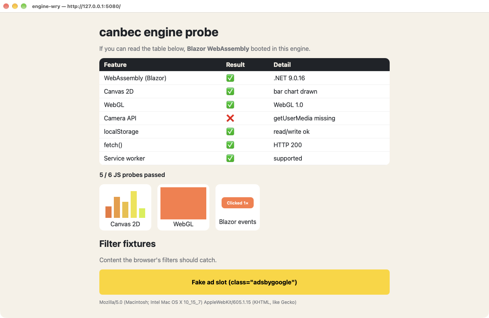 | 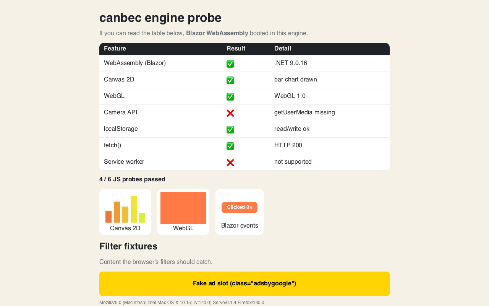 | 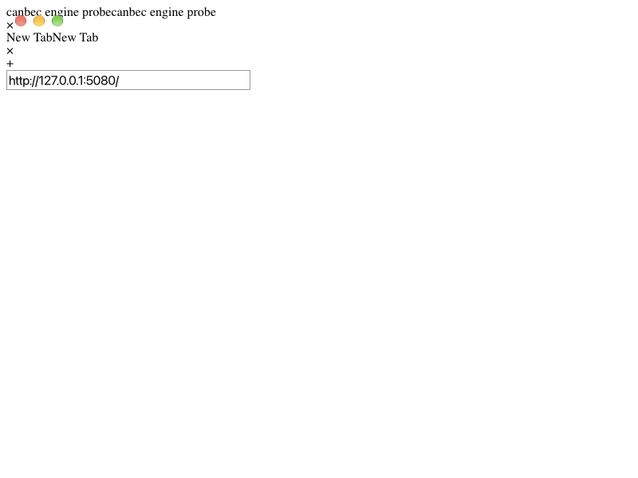 |
| ✅ **5/6** · 1.5 MB · 47 s build | ✅ 4/6 with shim · 143 MB · 7 m 45 s | ❌ no WASM · 51 MB |

**Decision:** the core talks only to an `Engine` interface. wry is the default, Servo is the
pure-Rust option, and Chromium (CEF) or others can be plugged in later.

## 🎯 Features

| Feature | Idea | Progress |
|---|---|---|
| 🧱 **Engine** | Real web apps (WASM, WebGL, Canvas) on 3 OSes, pluggable engines | `▓▓▓▓▓▓▓▓░░` wry works; Servo runs in a window (experimental) |
| 🗂️ **Tab discipline** | At most 20 open, auto-archive into folders, soft delete after 2 months | `▓▓▓▓▓▓▓▓░░` works, recently closed tabs |
| ⚠️ **Slop tagging** | One click, red frame on every next visit | `▓▓▓▓▓▓▓▓░░` works, shared lists |
| 🔕 **Feed blocker** | Feeds hidden, unlock only in settings, max 6 h | `▓▓▓▓▓▓▓▓░░` works, 10 s wait, own site list |
| 🚫 **No ads** | Ads blurred + grey hatching | `▓▓▓▓▓▓▓░░░` EasyList cosmetic rules, updated weekly |
| 🔞 **Adult lock** | Every navigation checked + system DNS lock | `▓▓▓▓▓▓▓▓░░` browser + family DNS |
| 🕵️ **No tracking** | Fresh profile every start, fingerprint noise, tracker blocking, clean links | `▓▓▓▓▓▓▓▓▓░` done, tested on macOS and Linux; Windows needs a hand test |
| ⚙️ **Settings** | Full-window page with search: feeds, privacy, profiles, AI, downloads, shortcuts | `▓▓▓▓▓▓▓▓░░` works |
| 👤 **Profiles** | Separate identities, MCP access per profile | `▓▓▓▓▓▓▓▓░░` works |
| 🔎 **Human search** | "Obsolete" badge for results first seen after 2023 | `▓▓▓▓▓░░░░░` badge on DuckDuckGo; own search later |
| 🫥 **AI spoilers** | AI images behind a click-to-reveal overlay | `▓▓▓▓▓▓░░░░` works from image metadata |
| 🧩 **Extensions** | Chrome MV3 subset + an AI skill that ports extensions | `▓▓▓▓▓░░░░░` subset + skill; needs a hand test |
| 🤖 **MCP** | Opt-in local server, agents browse through the same filters | `▓▓▓▓▓▓▓░░░` works, per profile |
| 🧠 **AI text hints** | A small local model flags text that reads like AI, opt-in | `▓▓▓▓▓░░░░░` built, resumable download; needs a hand test |
| 🪟 **Layouts** | As little browser as you want: Sidebar, Compact, Rail, Top bar | `▓▓▓▓▓▓▓▓░░` four layouts; a corner layout [prototype](docs/research/12-unifi-look.md) |
| 🎨 **Customization** | `theme.css` tokens + an AI skill to restyle, app icons | `▓▓▓▓▓▓▓░░░` theme.css, skill, 7 icons, light and dark |

## 🚀 Try it

**Download:** grab the build for your OS from [Releases](https://github.com/Cod3rs-org/canbec/releases)
(or the latest CI run's artifacts). The macOS app isn't signed yet, so the first time right-click
it → **Open**. Linux needs WebKitGTK 4.1 installed.

**Updates:** canbec checks GitHub Releases once a day. When there's a newer version, an
**⬆ Update** chip shows in the sidebar. On macOS one click downloads it, checks its SHA-256, swaps
the app and restarts. On Windows/Linux it opens the release page.

**Or build it yourself:**

```sh
git clone https://github.com/Cod3rs-org/canbec && cd canbec
cargo run --release -p canbec              # Linux also needs WebKitGTK 4.1 (see CI workflow)
cargo test --workspace                     # tests
tools/install-macos.sh                     # macOS: build + install to /Applications (again after git pull)
(cd src/engines/servo && cargo run --release -- --window)   # the same UI on Servo (~8 min first build)
```

**Pick a layout:** Settings → Appearance → Layout. Sidebar (300 px), Compact (240 px), Rail (icons
only; it opens to full width when you type an address) or Top bar (one 48 px strip with a ▾ panel).
Settings always fill the whole window.

**Make it yours:** put CSS variables into `theme.css` in your config folder, and they override the
sidebar. The config folder is `~/Library/Application Support/canbec` on macOS, `~/.config/canbec`
on Linux and `%APPDATA%\canbec` on Windows.

```css
:root { --acc: #4fae6b; --bg: #fbfaf7; }
```

Ready-made: [calm forest, high contrast, night owl](docs/themes/). Or ask Claude: the repo has a
[`canbec-theme` skill](.claude/skills/canbec-theme/SKILL.md) that writes `theme.css` from a description.

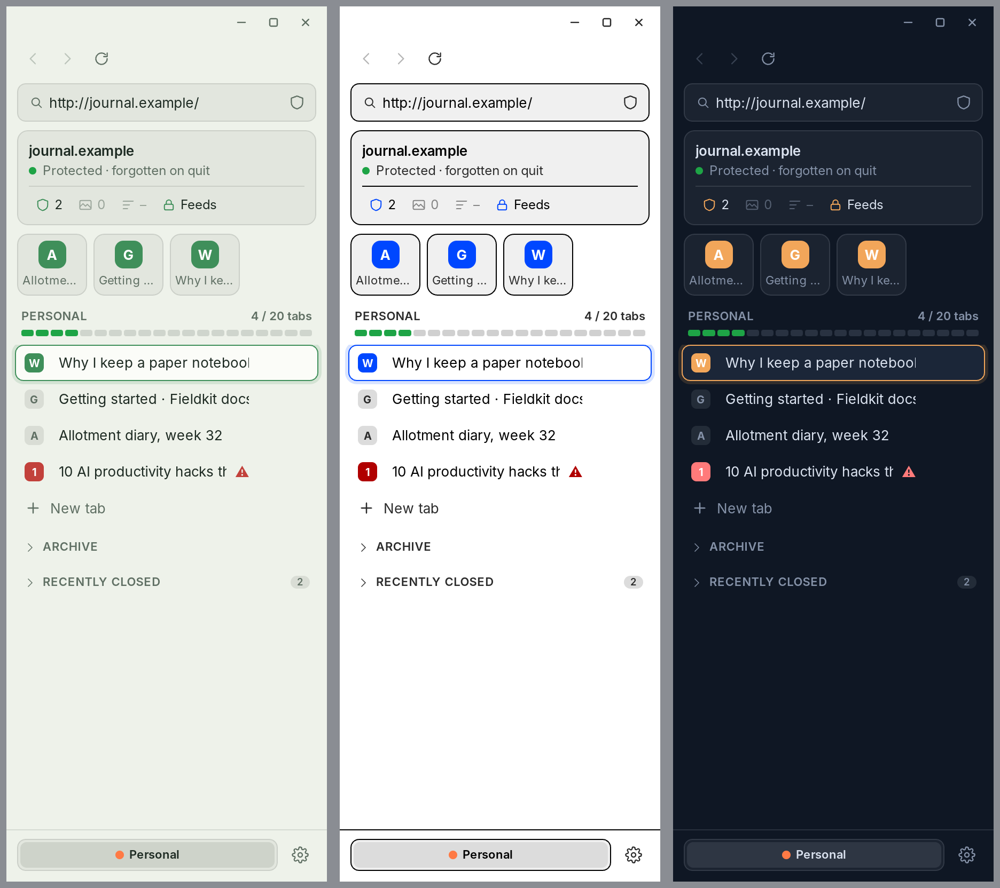

**Let an AI agent browse (through the same filters):** tick **AI agents** on a profile in
Settings → Profiles (best a separate "Agent" profile without your logins), then add canbec as an
MCP server. Tools: `search`, `open`, `read`, `list_tabs`.

```sh
claude mcp add canbec -- /Applications/canbec.app/Contents/MacOS/canbec --mcp
```

**Pick your icon:** in Settings → Appearance, or create a file named `icon` in the same folder and write a built-in name (see
[Icons](#-icons)) or a path to your own PNG into it:

```sh
echo spoiler > ~/Library/Application\ Support/canbec/icon      # macOS
echo ~/Pictures/my-icon.png > ~/.config/canbec/icon            # Linux, custom PNG (max 1024 px)
```

## 🏗️ How it's built

```
 sidebar (src/ui, HTML)  ──commands──▶  BrowserService (application)  ──▶  Engine port ──▶ wry | Servo | …
          ▲                                    │  rules (domain)            StateStore ──▶ JSON file
          └────────────── state ───────────────┘
```

```
src/domain          rules: tabs, slop, feed lock, blocklists (no I/O)
src/application     use cases + ports (Engine, StateStore)
src/infrastructure  wry engine, JSON store, blocklists, content script
src/app             the browser binary (wiring, window)
src/ui              sidebar and settings: plain HTML/CSS/JS
src/engines/servo   optional Servo engine (own workspace, headless runner or --window)
src/prototypes      engine bake-off crates
test/               Rust tests, Blazor WASM engine probe, fixtures, demo sites for screenshots
docs/               research, decisions, screenshots, logos
```

## 🎨 Icons

**Default is `sprout`**, a mouse pointer with a sprout growing out of it, because you are taking your
life back from the screen. All seven come with the app: pick one in Settings → Appearance, or write its
name into the `icon` file (see [Try it](#-try-it)). They share one look: a white sign on the blue of the
interface, with green for the human part.

|  | 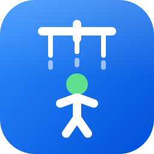 | 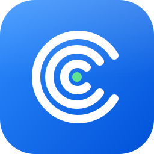 |  | 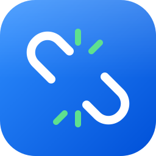 | 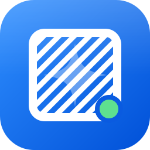 | 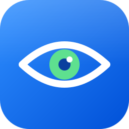 |
|:-:|:-:|:-:|:-:|:-:|:-:|:-:|
| **`sprout`** ⭐ | `strings` | `fingerprint` | `parrot` | `broken-link` | `spoiler` | `calm-eye` |
| your life growing back | strings cut, a free person | your own fingerprint, a C | your own words, not repeated | the scroll habit, cut | AI hidden under hatching | a calm eye on the human web |

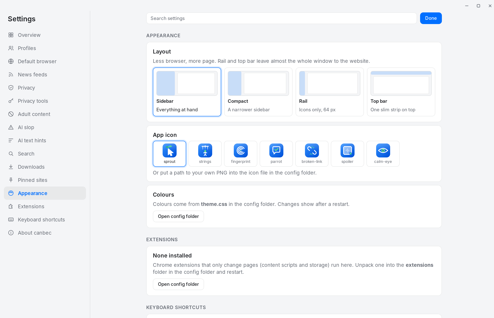
