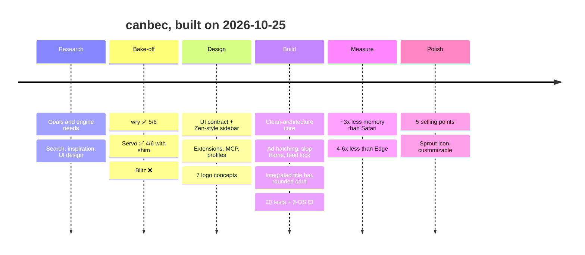

<div align="center">


# canbec

### **C**ontrol **A**I, **N**ot **B**e **C**ontrolled

**De-AI your life. Un-addict your life.**

*A lightweight, cross-platform browser written in Rust that hides AI slop, ads, adult content and
infinite feeds, so you browse the web as a human, not a parrot.*


</div>

---

## Why I made this

The web got loud. AI-generated pages bury the human ones, feeds are built so they never end, and
twenty forgotten tabs are nagging you in the background. I wanted a browser where I can live my life
as a normal human being and not as a parrot, so I built one.

canbec is a quiet browser with hard limits. You set them once, and you can't just turn them off in
a weak moment.

## ✨ 5 reasons to switch

1. 🔕 **Hard limits for weak moments.** Infinite feeds are gone. If you really need them, you have
   to go to settings and you get **6 hours max**. Adult content has **no off switch** at all.
2. ⚠️ **Mark AI slop once, get warned forever.** One click on the shield, and the site gets an
   orange frame on every visit. AI images get a spoiler, and search marks pages first seen after 2023.
3. 🗂️ **20 tabs, no hoarding.** Idle tabs move to folders by themselves and disappear after two
   months, but nothing is ever really deleted.
4. 🪶 **Small and fast.** 4 MB app, opens in 0.3 s and uses about **3× less memory than Safari**
   ([benchmarks](docs/benchmarks/2026-10-25-macos.md)).
5. 🔒 **Private and yours.** No telemetry, no accounts. Theme and icon are plain files you can edit,
   and AI agents get in only if you allow it, per profile.

| | |
|:-:|:-:|
|  |  |
| 🔕 **No infinite feeds.** The YouTube home feed is just gone. Unlocking is only in settings, **6 hours max**. | ⚠️ **What you tag stays tagged.** One click on the shield, and the site has an orange frame on every visit. |
|  |  |
| 🚫 **Ads become grey hatching.** The layout stays the same, the ad just doesn't get your attention. | 🧘 **Calm by default.** Vertical tabs, max 20 open, idle tabs move to folders by themselves. |

And under the hood:
- 🔞 **Adult content is blocked** on every navigation, also offline, no off switch (system DNS lock is next).
- 🫥 **AI images get a spoiler overlay** (C2PA / IPTC metadata first). *In progress.*
- 🔎 **Human search**: results first seen after 2023 are marked *obsolete*. For now, search goes
  to [DuckDuckGo NoAI](https://noai.duckduckgo.com).

## 🛤️ What is done so far



| # | Step | Status | Read more |
|:-:|------|:------:|-----------|
| 1 | Repo set up | ✅ | |
| 2 | First research: what real apps need from an engine | ✅ | [01](docs/research/01-initial-findings.md) |
| 3 | Search without AI: comparison and plan | ✅ | [02](docs/research/02-search.md) |
| 4 | Open-source inspiration | ✅ | [03](docs/research/03-inspiration.md) |
| 5 | UI: vertical tabs, 20-tab discipline, slop tagging | ✅ | [04](docs/research/04-ui-and-tabs.md) |
| 6 | Engine bake-off with a local Blazor WASM probe | ✅ | [05](docs/research/05-engine-bakeoff.md) |
| 7 | Extensibility: any engine, Chrome extension subset, feed lock, MCP, profiles | ✅ design | [06](docs/research/06-extensibility.md) |
| 8 | Sidebar UI (vanilla HTML/CSS/JS, ~16 KB) | ✅ | [ui-contract](docs/architecture/ui-contract.md) |
| 9 | **First working browser** (domain / application / infrastructure / app) | ✅ | [src/](src/) |
| 10 | Integrated title bar (macOS) + own window buttons (Windows / Linux), rounded card | ✅ | |
| 11 | Benchmarks vs Safari and Edge: about 3× less memory | ✅ | [benchmarks](docs/benchmarks/2026-10-25-macos.md) |
| 12 | 5 selling points, sprout as the default icon, customizable app icon | ✅ | [icons](#-icons) |
| 13 | Roadmap: customization, local model, HN launch | 📝 | [07](docs/research/07-roadmap-notes.md) |

📚 **All docs:** [docs/README.md](docs/README.md)

## ⚡ Benchmarks

macOS, same pages, median of 3 runs ([details and caveats](docs/benchmarks/2026-10-25-macos.md)):

| Browser | Size | Time to window | Memory (Wikipedia) | Processes |
|---|--:|--:|--:|--:|
| **canbec** | **4 MB** | **0.33 s** | **323 MB** | **5** |
| Safari | 35 MB | 1.08 s | 976 MB | 11 |
| Microsoft Edge | 1,111 MB | 0.64 s | 1,963 MB | 15 |

## 🧪 Engine bake-off

I ran the same local Blazor WebAssembly probe ([`test/engine-probe`](test/engine-probe)) in every engine:

| wry (system webview) | Servo 0.1.4 | Blitz 0.3 |
|:-:|:-:|:-:|
|  |  |  |
| ✅ **5/6** · 1.5 MB · 47 s build | ✅ 4/6 with shim · 143 MB · 7 m 45 s | ❌ no WASM · 51 MB |

**Decision:** the core talks only to an `Engine` interface. wry is the default, Servo is the
pure-Rust option, and Chromium (CEF) or others can be plugged in later.

## 🎯 Features

| Feature | Idea | Progress |
|---|---|---|
| 🧱 **Engine** | Real web apps (WASM, WebGL, Canvas) on 3 OSes, pluggable engines | `▓▓▓▓▓▓░░░░` wry works |
| 🗂️ **Tab discipline** | At most 20 open, auto-archive into folders, soft delete after 2 months | `▓▓▓▓▓▓░░░░` core + UI |
| ⚠️ **Slop tagging** | One click, orange frame on every next visit | `▓▓▓▓▓▓░░░░` works |
| 🔕 **Feed blocker** | Feeds hidden, unlock only in settings, max 6 h | `▓▓▓▓▓░░░░░` works, no settings UI yet |
| 🚫 **No ads** | Ads blurred + grey hatching | `▓▓▓▓░░░░░░` basic selectors (adblock-rust next) |
| 🔞 **Adult lock** | Every navigation checked + system DNS lock | `▓▓▓▓░░░░░░` browser part done |
| 👤 **Profiles** | Separate identities, MCP access per profile | `▓░░░░░░░░░` designed |
| 🔎 **Human search** | "Obsolete" badge for results first seen after 2023 | `▓▓░░░░░░░░` designed |
| 🫥 **AI spoilers** | AI images behind a click-to-reveal overlay | `▓░░░░░░░░░` researched |
| 🧩 **Extensions** | Chrome MV3 subset + an AI skill that ports extensions | `▓░░░░░░░░░` designed |
| 🤖 **MCP** | Opt-in local server, agents browse through the same filters | `▓░░░░░░░░░` designed |
| 🎨 **Customization** | `theme.css` tokens (works now) + an AI skill to restyle | `▓▓▓░░░░░░░` theme.css |

## 🚀 Try it

```sh
git clone https://github.com/Cod3rs-org/canbec && cd canbec
cargo run --release -p canbec              # Linux also needs WebKitGTK 4.1 (see CI workflow)
cargo test --workspace                     # 23 tests
```

**Make it yours:** put CSS variables into `theme.css` in your config folder, and they override the
sidebar. The config folder is `~/Library/Application Support/canbec` on macOS, `~/.config/canbec`
on Linux and `%APPDATA%\canbec` on Windows.

```css
:root { --acc: #4fae6b; --bg: #fbfaf7; }
```

**Pick your icon:** create a file named `icon` in the same folder and write a built-in name (see
[Icons](#-icons)) or a path to your own PNG into it:

```sh
echo spoiler > ~/Library/Application\ Support/canbec/icon      # macOS
echo ~/Pictures/my-icon.png > ~/.config/canbec/icon            # Linux, custom PNG (max 1024 px)
```

## 🏗️ How it's built

```
 sidebar (src/ui, HTML)  ──commands──▶  BrowserService (application)  ──▶  Engine port ──▶ wry | Servo | …
          ▲                                    │  rules (domain)            StateStore ──▶ JSON file
          └────────────── state ───────────────┘
```

```
src/domain          rules: tabs, slop, feed lock, blocklists (no I/O)
src/application     use cases + ports (Engine, StateStore)
src/infrastructure  wry engine, JSON store, blocklists, content script
src/app             the browser binary (wiring, window)
src/ui              sidebar: plain HTML/CSS/JS
src/prototypes      engine bake-off crates
test/               Rust tests, Blazor WASM engine probe, fixtures
docs/               research, decisions, screenshots, logos
```

## 🎨 Icons

**Default is `sprout`**, a mouse pointer with a sprout growing out of it, because you are taking your
life back from the screen. All seven come with the app, you pick one in the `icon` file (see [Try it](#-try-it)).

|  |  |  |  |  |  |  |
|:-:|:-:|:-:|:-:|:-:|:-:|:-:|
| **`sprout`** ⭐ | `strings` | `fingerprint` | `parrot` | `broken-link` | `spoiler` | `calm-eye` |
| growing back online | cut puppet strings | human uniqueness | not a parrot | break the scroll | AI hidden | calm, protected |
