<div align="center">

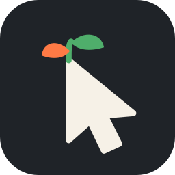

# canbec

### **C**ontrol **A**I, **N**ot **B**e **C**ontrolled

**De-AI your life. Un-addict your life.**

*A lightweight, cross-platform browser written in Rust that hides AI slop, ads, adult content and
infinite feeds, so you browse the web as a human, not a parrot.*


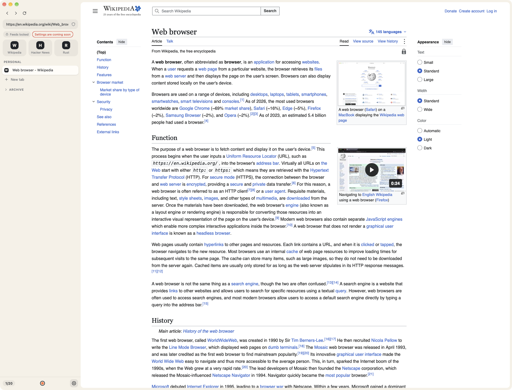

</div>

---

## Why I made this

The web got loud. AI-generated pages bury the human ones, feeds are built so they never end, and
twenty forgotten tabs are nagging you in the background. I wanted a browser where I can live my life
as a normal human being and not as a parrot, so I built one.

canbec is a quiet browser with hard limits. You set them once, and you can't just turn them off in
a weak moment.

## ✨ 5 reasons to switch

1. 🔕 **Hard limits for weak moments.** Infinite feeds are gone. If you really need them, you have
   to go to settings and you get **6 hours max**. Adult content has **no off switch** at all.
2. ⚠️ **Mark AI slop once, get warned forever.** One click on the shield, and the site gets an
   orange frame on every visit. AI images get a spoiler, and search marks pages first seen after 2023.
3. 🗂️ **20 tabs, no hoarding.** Idle tabs move to folders by themselves and disappear after two
   months, but nothing is ever really deleted.
4. 🪶 **Small and fast.** 4 MB app, opens in 0.3 s and uses about **2.7× less memory than Safari**
   ([macOS](docs/benchmarks/2026-10-25-macos.md)). On Windows it uses about 15% less than Chrome
   and about 4× less than Edge ([Windows](docs/benchmarks/2026-10-26-windows.md)).
5. 🕵️ **Nobody tracks you.** Every start is a fresh browser: cookies, storage and cache from last
   time are gone, every site sees a slightly different fingerprint, tracker requests are blocked
   and `utm_`/`fbclid` junk is cut from links. You stay logged in only where you say so. No
   telemetry, no accounts.

| | |
|:-:|:-:|
| 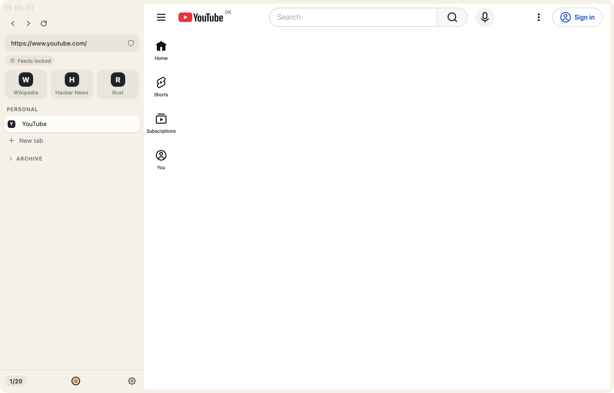 | 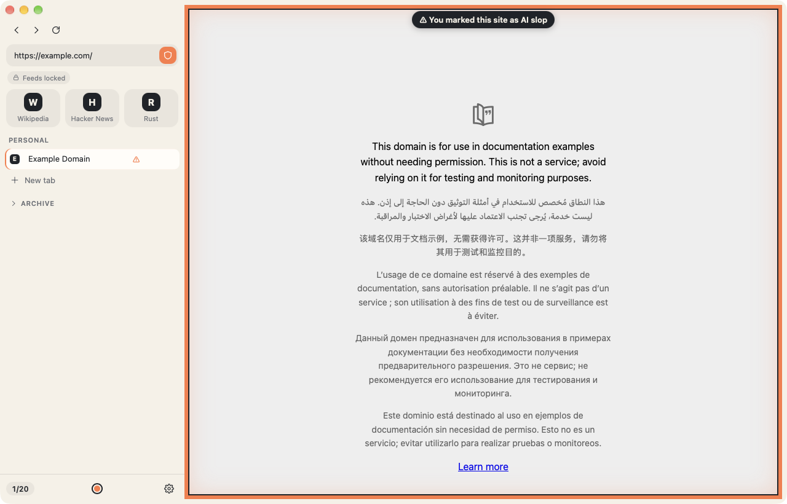 |
| 🔕 **No infinite feeds.** The YouTube home feed is just gone (also Reddit, X, Instagram, TikTok, Bluesky, Tumblr and more, plus your own in `feeds.txt`). Unlocking is only in settings, **6 hours max**. | ⚠️ **What you tag stays tagged.** One click on the shield, and the site has an orange frame on every visit. Share your list or follow others. Images whose metadata says "AI-generated" stay blurred until you click. |
| 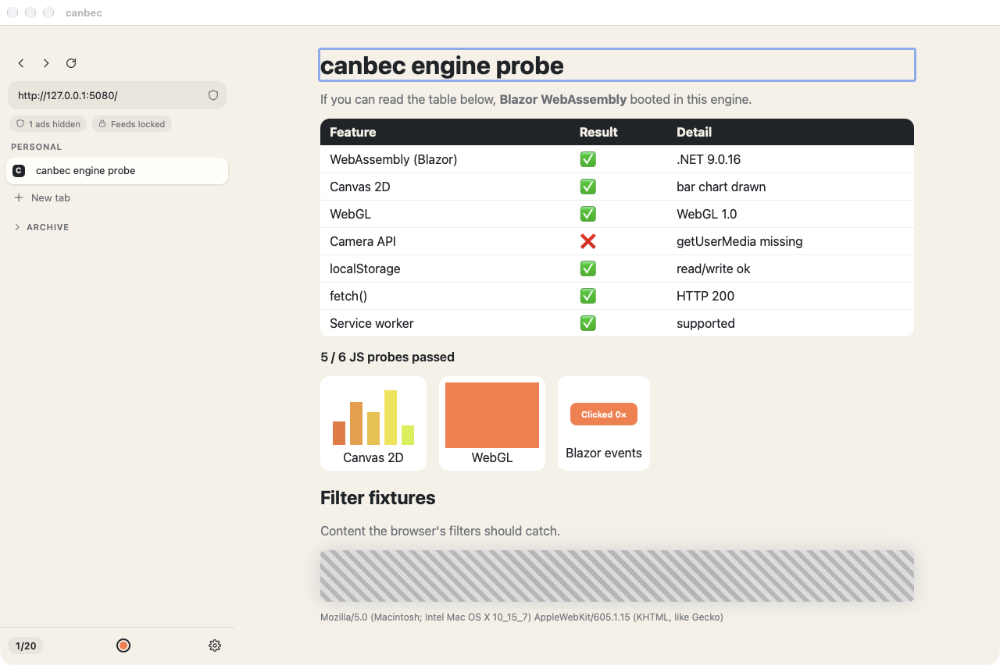 | 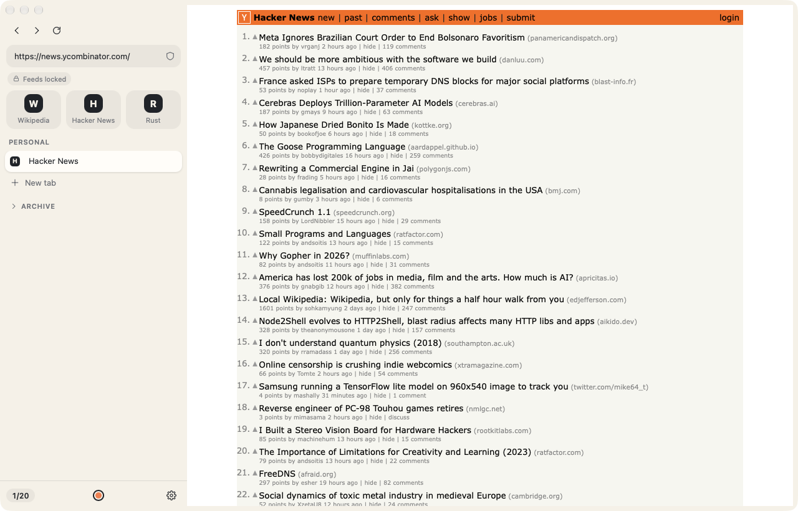 |
| 🚫 **Ads become grey hatching.** About 24k EasyList rules, updated every week. The layout stays the same, the ad just doesn't get your attention. | 🧘 **Calm by default.** Vertical tabs, max 20 open, idle tabs move to folders by themselves. |
| 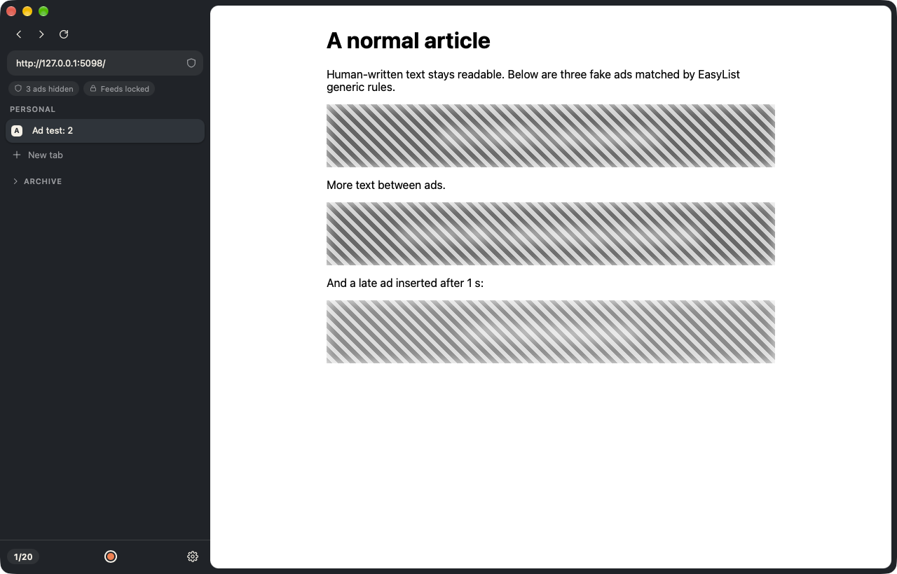 | 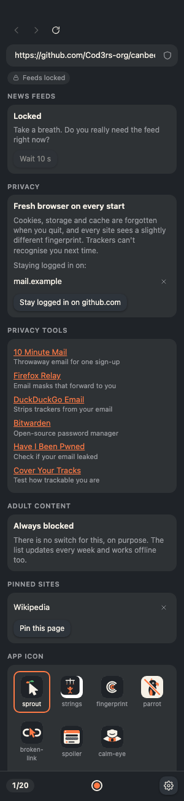 |
| 🧪 **Even late ads get covered**, also the ones a page adds after it loaded. | ⚙️ **Settings in the sidebar.** Feeds unlock only after a 10 s wait, privacy tools like 10 Minute Mail, pinned sites, app icon. |

And under the hood:
- ⌨️ **Normal browser stuff works:** Cmd/Ctrl+T, W, L, R, D (pin), F (find), +/-/0 (zoom, kept per site), `[` `]` (back/forward per tab), copy/paste, downloads
  to your Downloads folder.
- 🔞 **Adult content is blocked** on every navigation, also offline, no off switch (system DNS lock is next).
- 🫥 **AI images get a spoiler overlay** (C2PA / IPTC metadata first). *In progress.*
- 🔎 **Human search**: results first seen after 2023 are marked *obsolete*. For now, search goes
  to [DuckDuckGo NoAI](https://noai.duckduckgo.com).

## 🛤️ What is done so far

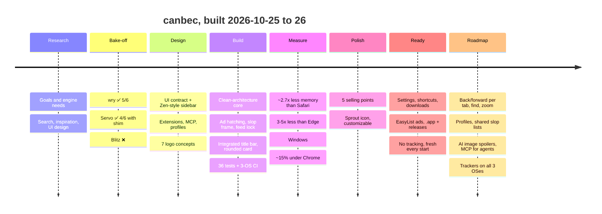

| # | Step | Status | Read more |
|:-:|------|:------:|-----------|
| 1 | Repo set up | ✅ | |
| 2 | First research: what real apps need from an engine | ✅ | [01](docs/research/01-initial-findings.md) |
| 3 | Search without AI: comparison and plan | ✅ | [02](docs/research/02-search.md) |
| 4 | Open-source inspiration | ✅ | [03](docs/research/03-inspiration.md) |
| 5 | UI: vertical tabs, 20-tab discipline, slop tagging | ✅ | [04](docs/research/04-ui-and-tabs.md) |
| 6 | Engine bake-off with a local Blazor WASM probe | ✅ | [05](docs/research/05-engine-bakeoff.md) |
| 7 | Extensibility: any engine, Chrome extension subset, feed lock, MCP, profiles | ✅ design | [06](docs/research/06-extensibility.md) |
| 8 | Sidebar UI (vanilla HTML/CSS/JS, ~16 KB) | ✅ | [ui-contract](docs/architecture/ui-contract.md) |
| 9 | **First working browser** (domain / application / infrastructure / app) | ✅ | [src/](src/) |
| 10 | Integrated title bar (macOS) + own window buttons (Windows / Linux), rounded card | ✅ | |
| 11 | Benchmarks vs Safari and Edge: about 2.7× less memory | ✅ | [benchmarks](docs/benchmarks/2026-10-25-macos.md) |
| 12 | 5 selling points, sprout as the default icon, customizable app icon | ✅ | [icons](#-icons) |
| 13 | Settings panel: feed unlock after a 10 s wait, pinned sites, live icon picker | ✅ | [contract](docs/architecture/ui-contract.md) |
| 14 | Keyboard shortcuts, macOS Edit menu (copy/paste), downloads | ✅ | |
| 15 | Real ad covering with EasyList, updated weekly | ✅ | [benchmarks](docs/benchmarks/2026-10-25-macos.md) |
| 16 | `canbec.app` bundle, packaged builds for 3 OSes, tag → GitHub release | ✅ | [ci.yml](.github/workflows/ci.yml) |
| 17 | **No tracking:** fresh browser every start, fingerprint noise, tracker blocking, clean links, privacy tools | ✅ | [08](docs/research/08-privacy.md) |
| 18 | Full plan: 33 issues in 4 milestones (release, every OS equal, human web, agents & extensions) | 📝 | [ROADMAP](docs/ROADMAP.md) |
| 19 | Browser basics: back/forward per tab, find in page, zoom per site, Cmd+click → new tab, camera/mic prompts, crash reload | ✅ | [#6–#11](https://github.com/Cod3rs-org/canbec/milestone/1) |
| 20 | Tracker blocking with EasyPrivacy path rules on macOS; Linux (WebKitGTK) and Windows (WebView2) wired, need a hand test | ✅ / 🧪 | [#12](https://github.com/Cod3rs-org/canbec/issues/12) [#13](https://github.com/Cod3rs-org/canbec/issues/13) [#21](https://github.com/Cod3rs-org/canbec/issues/21) |
| 21 | Feed lock on 12 sites + your own `feeds.txt` | ✅ | [#22](https://github.com/Cod3rs-org/canbec/issues/22) |
| 22 | **Profiles:** own tabs, tags and logins per profile; shared slop lists | ✅ | [#26](https://github.com/Cod3rs-org/canbec/issues/26) [#27](https://github.com/Cod3rs-org/canbec/issues/27) |
| 23 | **AI images blurred** when their metadata says so | ✅ | [#24](https://github.com/Cod3rs-org/canbec/issues/24) |
| 24 | **MCP server:** AI agents browse through the same filters, only when you allow it | ✅ | [#28](https://github.com/Cod3rs-org/canbec/issues/28) |
| 25 | Windows benchmarks vs Chrome and Edge: about 15% less memory than Chrome, about 4× less than Edge | ✅ | [benchmarks](docs/benchmarks/2026-10-26-windows.md) |

📚 **All docs:** [docs/README.md](docs/README.md) · 🗺️ **What's next:** [ROADMAP](docs/ROADMAP.md) / [issues](https://github.com/Cod3rs-org/canbec/issues)

## ⚡ Benchmarks

macOS, same pages, median of 3 runs ([details and caveats](docs/benchmarks/2026-10-25-macos.md)):

| Browser | Size | Time to window | Memory (Wikipedia) | Processes |
|---|--:|--:|--:|--:|
| **canbec** | **4 MB** | **0.33 s** | **358 MB** | **5** |
| Safari | 35 MB | 1.08 s | 976 MB | 11 |
| Microsoft Edge | 1,111 MB | 0.64 s | 1,963 MB | 15 |

Windows 11, same pages, median of 5 runs ([details and caveats](docs/benchmarks/2026-10-26-windows.md)).
Memory is private memory, so shared pages aren't counted twice:

| Browser | Size | Time to window | Memory (Wikipedia) | Processes |
|---|--:|--:|--:|--:|
| **canbec** | **4.5 MB** + WebView2 (part of Windows) | **0.08 s** | **367 MB** | **8** |
| Google Chrome | 505 MB | 0.52 s | 432 MB | 11 |
| Microsoft Edge | 1,785 MB | 0.54 s | 1,527 MB | 24 |

On Windows canbec runs Chrome's engine (WebView2), so it saves less than on macOS. The
"time to window" for canbec is before WebView2 has started, so it's not first paint.

## 🧪 Engine bake-off

I ran the same local Blazor WebAssembly probe ([`test/engine-probe`](test/engine-probe)) in every engine:

| wry (system webview) | Servo 0.1.4 | Blitz 0.3 |
|:-:|:-:|:-:|
| 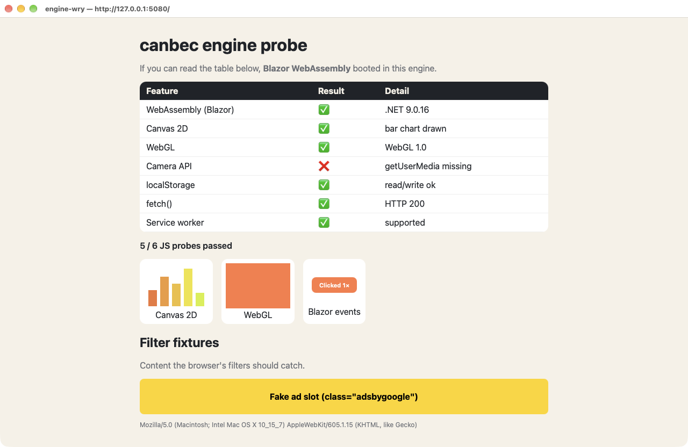 | 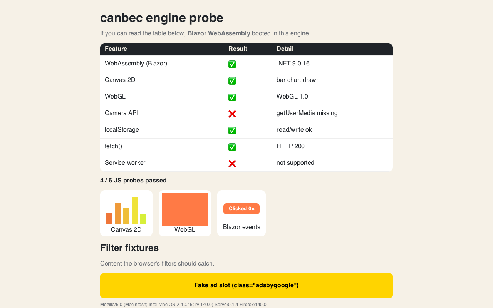 | 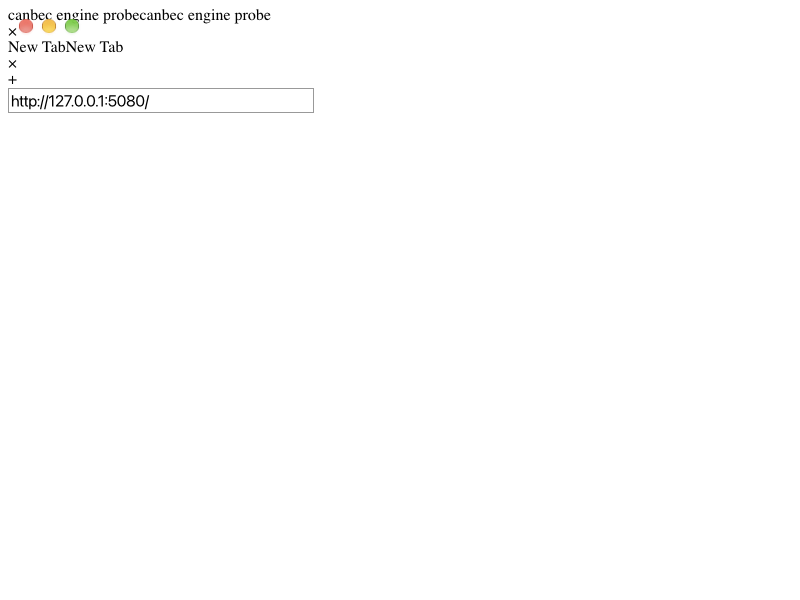 |
| ✅ **5/6** · 1.5 MB · 47 s build | ✅ 4/6 with shim · 143 MB · 7 m 45 s | ❌ no WASM · 51 MB |

**Decision:** the core talks only to an `Engine` interface. wry is the default, Servo is the
pure-Rust option, and Chromium (CEF) or others can be plugged in later.

## 🎯 Features

| Feature | Idea | Progress |
|---|---|---|
| 🧱 **Engine** | Real web apps (WASM, WebGL, Canvas) on 3 OSes, pluggable engines | `▓▓▓▓▓▓░░░░` wry works |
| 🗂️ **Tab discipline** | At most 20 open, auto-archive into folders, soft delete after 2 months | `▓▓▓▓▓▓░░░░` core + UI |
| ⚠️ **Slop tagging** | One click, orange frame on every next visit | `▓▓▓▓▓▓░░░░` works |
| 🔕 **Feed blocker** | Feeds hidden, unlock only in settings, max 6 h | `▓▓▓▓▓▓▓▓░░` works, settings with a 10 s wait |
| 🚫 **No ads** | Ads blurred + grey hatching | `▓▓▓▓▓▓▓░░░` EasyList cosmetic rules, updated weekly |
| 🔞 **Adult lock** | Every navigation checked + system DNS lock | `▓▓▓▓░░░░░░` browser part done |
| 🕵️ **No tracking** | Fresh profile every start, fingerprint noise, tracker blocking, clean links | `▓▓▓▓▓▓▓░░░` done; tracker blocking macOS only |
| ⚙️ **Settings** | Feeds, privacy, pinned sites, icon, all in the sidebar | `▓▓▓▓▓▓▓░░░` works |
| 👤 **Profiles** | Separate identities, MCP access per profile | `▓░░░░░░░░░` designed |
| 🔎 **Human search** | "Obsolete" badge for results first seen after 2023 | `▓▓░░░░░░░░` designed |
| 🫥 **AI spoilers** | AI images behind a click-to-reveal overlay | `▓░░░░░░░░░` researched |
| 🧩 **Extensions** | Chrome MV3 subset + an AI skill that ports extensions | `▓░░░░░░░░░` designed |
| 🤖 **MCP** | Opt-in local server, agents browse through the same filters | `▓░░░░░░░░░` designed |
| 🎨 **Customization** | `theme.css` tokens (works now) + an AI skill to restyle | `▓▓▓░░░░░░░` theme.css |

## 🚀 Try it

**Download:** grab the build for your OS from [Releases](https://github.com/Cod3rs-org/canbec/releases)
(or the latest CI run's artifacts). The macOS app isn't signed yet, so the first time right-click
it → **Open**. Linux needs WebKitGTK 4.1 installed.

**Or build it yourself:**

```sh
git clone https://github.com/Cod3rs-org/canbec && cd canbec
cargo run --release -p canbec              # Linux also needs WebKitGTK 4.1 (see CI workflow)
cargo test --workspace                     # 51 tests
```

**Make it yours:** put CSS variables into `theme.css` in your config folder, and they override the
sidebar. The config folder is `~/Library/Application Support/canbec` on macOS, `~/.config/canbec`
on Linux and `%APPDATA%\canbec` on Windows.

```css
:root { --acc: #4fae6b; --bg: #fbfaf7; }
```

Ready-made: [calm forest, high contrast, night owl](docs/themes/). Or ask Claude: the repo has a
[`canbec-theme` skill](.claude/skills/canbec-theme/SKILL.md) that writes `theme.css` from a description.

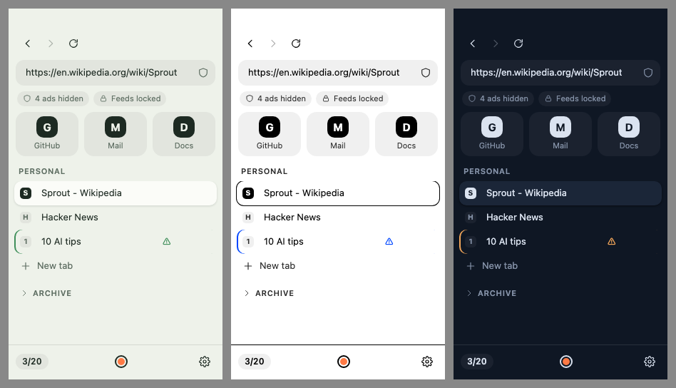

**Let an AI agent browse (through the same filters):** tick **AI agents** on a profile in
Settings → Profiles (best a separate "Agent" profile without your logins), then add canbec as an
MCP server. Tools: `search`, `open`, `read`, `list_tabs`.

```sh
claude mcp add canbec -- /Applications/canbec.app/Contents/MacOS/canbec --mcp
```

**Pick your icon:** create a file named `icon` in the same folder and write a built-in name (see
[Icons](#-icons)) or a path to your own PNG into it:

```sh
echo spoiler > ~/Library/Application\ Support/canbec/icon      # macOS
echo ~/Pictures/my-icon.png > ~/.config/canbec/icon            # Linux, custom PNG (max 1024 px)
```

## 🏗️ How it's built

```
 sidebar (src/ui, HTML)  ──commands──▶  BrowserService (application)  ──▶  Engine port ──▶ wry | Servo | …
          ▲                                    │  rules (domain)            StateStore ──▶ JSON file
          └────────────── state ───────────────┘
```

```
src/domain          rules: tabs, slop, feed lock, blocklists (no I/O)
src/application     use cases + ports (Engine, StateStore)
src/infrastructure  wry engine, JSON store, blocklists, content script
src/app             the browser binary (wiring, window)
src/ui              sidebar: plain HTML/CSS/JS
src/prototypes      engine bake-off crates
test/               Rust tests, Blazor WASM engine probe, fixtures
docs/               research, decisions, screenshots, logos
```

## 🎨 Icons

**Default is `sprout`**, a mouse pointer with a sprout growing out of it, because you are taking your
life back from the screen. All seven come with the app, you pick one in the `icon` file (see [Try it](#-try-it)).

|  | 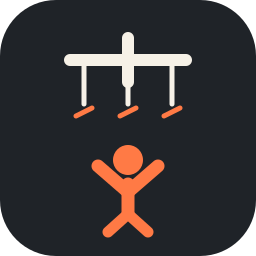 |  | 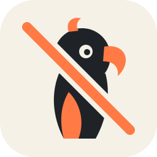 |  |  |  |
|:-:|:-:|:-:|:-:|:-:|:-:|:-:|
| **`sprout`** ⭐ | `strings` | `fingerprint` | `parrot` | `broken-link` | `spoiler` | `calm-eye` |
| growing back online | cut puppet strings | human uniqueness | not a parrot | break the scroll | AI hidden | calm, protected |
