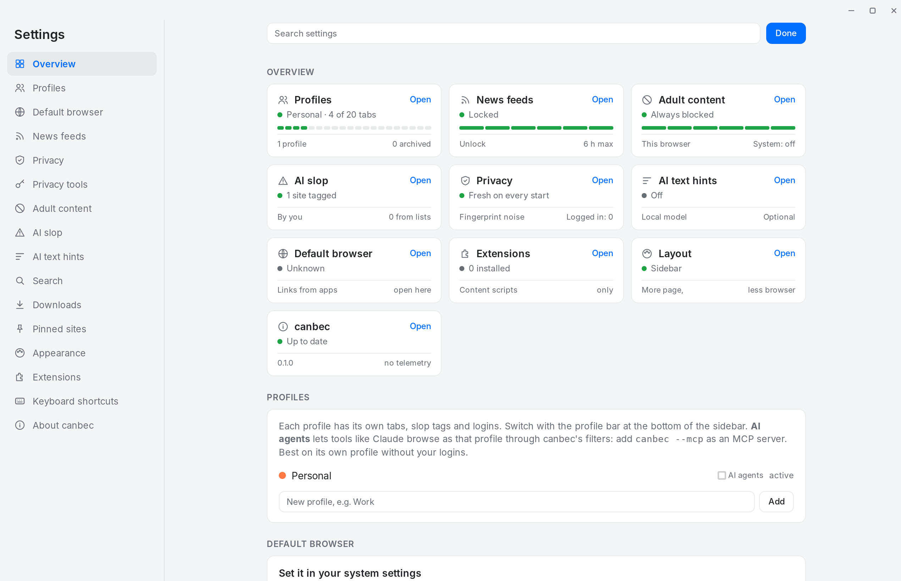

# 12 · A calmer, UniFi-style look

The first sidebar was warm paper and orange. It read as a toy next to the sites it frames. The
owner pointed at Ubiquiti's UniFi Site Manager as the look to aim for: a flat grey frame, white
cards with a hairline border, one blue accent, green status dots and segmented bars.

## What changed

| Before | Now | Why |
|---|---|---|
| Beige `#f6f1e7`, orange accent | Grey `#f4f5f7` / `#131417`, blue `#006fff` / `#4c97ff` | Neutral frame lets the website be the colour; blue is the usual "this is selected" signal |
| Chips under the address bar | **Site card**: host, status dot (Protected / Loading / Tagged as AI slop), icon row with ads hidden, AI images blurred, AI text %, feed lock | One glance shows what canbec did on this page, like a UniFi device tile |
| `6/20` pill in the footer | **Tab budget meter**: 20 segments under the profile name, green → amber at 80% → red at the cap | The soft cap becomes something you see filling up, not a number |
| Profile dots | **Segmented profile switch** with names | Dots needed a hover to tell profiles apart |
| Settings menu as text | Menu with line icons, plus an **Overview** grid of status tiles (Profiles, Feeds, Adult content, AI slop, Privacy, AI text hints, Default browser, Extensions, Updates) | Site Manager's card grid: status first, details one click away |
| Shadows on active things | 1 px borders, a blue border + soft ring on the active tab/tile | Flat and crisp on both light and dark |

## Kept

- Same CSS variable names, so `theme.css` files keep working. New optional `--ok` (green).
  The focus ring uses `color-mix()` on `--acc`; engines without it just skip the ring.
- No new state or commands: the UI contract is unchanged, everything comes from existing fields.
- No web fonts or icon packs: system font and inline SVG, so the sidebar still loads offline instantly.

## Layouts: less browser, more page

Settings → Appearance → **Layout** (saved in `<config>/layout`, rule in `domain::layout`):

| Layout | Chrome | Website card starts at |
|---|---|---|
| Sidebar | 300 px sidebar | x 300 |
| Compact | 240 px sidebar, profile names become dots | x 240 |
| Rail | 64 px column: nav, search, pinned sites, tab monograms, profiles, gear | x 64 |
| Top bar | one 48 px strip: nav, address bar, horizontal tabs, new tab, gear | y 48, full width |

The rail has no room to type, so the search button, Cmd/Ctrl+L and Cmd/Ctrl+F **peek**: the
sidebar widens to the full 300 px (`peek` command, card moves), and folds back on Escape, on
navigating, on picking a tab, or when focus goes back to the page.

Settings stay a full-window page in every layout: the chrome webview always spans the window,
and the card is hidden while settings are open.

The top bar has a **▾ panel** (also `peek`): the card steps right by 312 px and the site card,
pinned sites, tab meter, profile switch, archive and recently closed drop down under the strip.
They are the same elements, moved into the panel while the layout is Top bar (`placeDrop`), so
there is one copy of each to keep working. Escape, picking a tab or clicking the page folds it.
